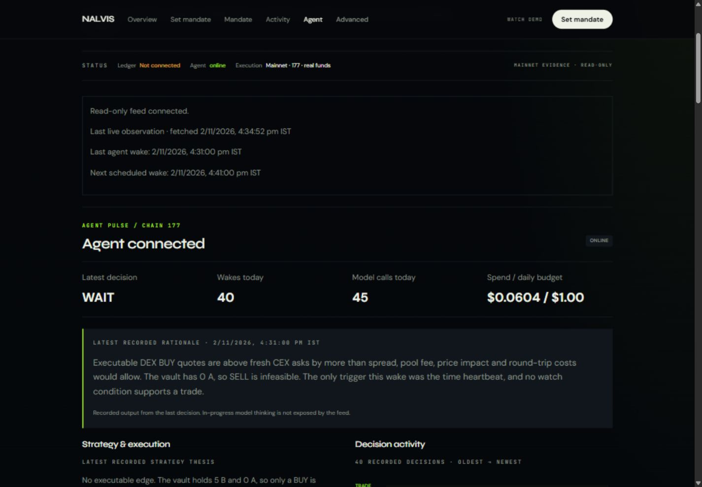
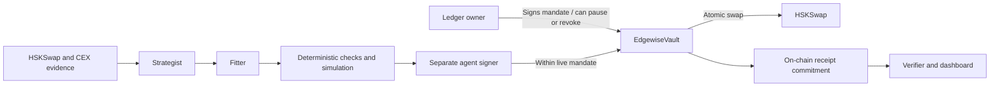
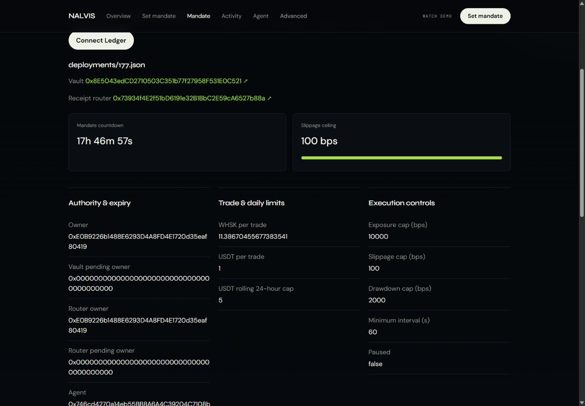
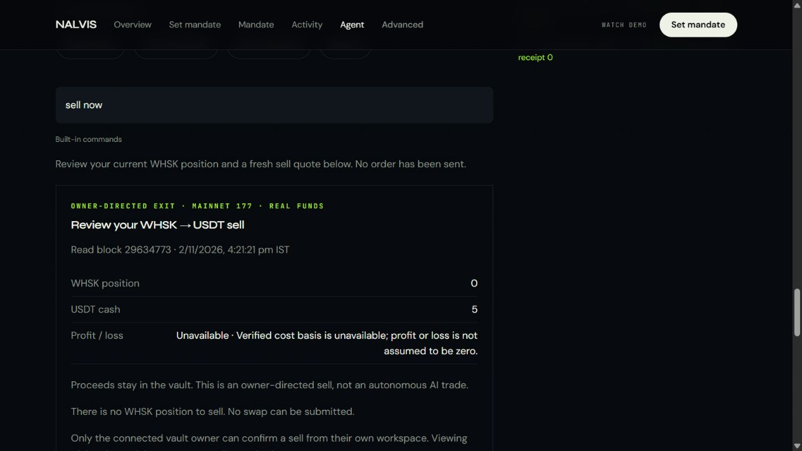

# Nalvis — hardware-governed DeFi automation

**Cold-key control. On-chain boundaries. Always-on agents. Verifiable decisions.**

Nalvis connects Ledger-held ownership to automated DeFi on **HashKey Chain**.
An owner signs a bounded mandate with their hardware wallet; a separate agent
monitors markets and can execute inside that mandate without requiring a new
hardware signature on every autonomous trade. The owner can pause or revoke
authority. Decisions leave inspectable evidence and hash-chained receipts.

**The distinctive combination:** a Ledger-owned mainnet vault, a live LLM
Strategist and Fitter, and contract-enforced limits around every agent action.
Judges can inspect the running agent, its mandate and its on-chain decisions.

Built for **HSK Chain Horizon · Track 1: AI Agent Trading**.

[Live app](https://nalvis-hsk-delta.vercel.app/) ·
[Mainnet agent](https://nalvis-hsk-delta.vercel.app/#/agent) ·
[Vault explorer](https://hsk.blockscout.com/address/0x8E5043edCD2710503C351b77f27958F531E0C521) ·
[DoraHacks copy](docs/submission/DORAHACKS.md) ·
[Video script](docs/submission/VIDEO-SCRIPT.md)

**Verify in three steps:** [watch the mainnet agent](https://nalvis-hsk-delta.vercel.app/#/agent),
[inspect the Ledger-owned vault](https://hsk.blockscout.com/address/0x8E5043edCD2710503C351b77f27958F531E0C521),
then [inspect the verified mainnet BUY](https://hsk.blockscout.com/tx/0x7a3020fb769d4181f235dc40483b74fe4c7408a02a311d5e30b3c16390d5722b).

### Live mainnet agent



Recorded decisions, market rationale, wake timestamps and operating status.

## Why Nalvis

Treasury owners and long-term holders should not have to give an unrestricted
key to a trading bot to participate in DeFi. Requiring a hardware confirmation
for every market response also prevents unattended operation.

Nalvis separates **ownership, strategy and execution authority**. It targets
the control and auditability needs of institutional-style treasury workflows:
keep the ownership key on hardware, allocate only an intended trading balance,
set explicit boundaries, and inspect what the agent actually did. Helping
holders manage risk and pursue asset-growth opportunities is the objective;
capital protection and returns are not guaranteed.

**Custody distinction:** the owner's key remains on the Ledger. Funds allocated
for trading reside in the smart-contract vault, not offline cold storage.
A separate hot agent key has bounded trading authority, not owner withdrawal
authority. This is an unaudited prototype, not a claim of institutional
production readiness or institutional adoption.

**Why there is no hot-wallet owner path:** this is a deliberate safety choice,
not an omitted browser-wallet feature. Nalvis keeps mandate changes, pause,
revoke and withdrawal authority on the Ledger for serious holders and
institutional-style treasury workflows. A scoped agent can automate execution
inside the signed envelope without unrestricted custody of the owner's key.

## Features

- **Ledger-governed mandate:** agent identity, expiry, per-token trade caps,
  rolling daily turnover, exposure, slippage, drawdown and minimum interval.
  Owner controls include pause, unpause, revoke and withdrawal. **Revoke
  immediately removes the agent's trading authority on-chain**; a queued or
  future agent order cannot bypass the revoked mandate.
- **Strategist + Fitter:** the strategist proposes actions and market watches;
  the fitter negotiates a compliant proposal. Deterministic checks, simulation
  and the vault govern execution. The LLM never signs transactions or creates
  prices, recipients, calldata or minimum-output values.
- **Real market monitoring:** HSKSwap WHSK/USDT quotes and pool data, with fresh
  MEXC/Gate context. The active `fresh-dex-cex` policy excludes stale APRO from
  decisions instead of inventing fresh oracle data.
- **Bounded execution:** a successful vault trade swaps through HSKSwap and
  records a receipt atomically. Exact-amount approvals reset after use; TWAP,
  output-floor, nonce and receipt-head checks remain authoritative.
- **Evidence and verification:** journals/artifacts persist on OCI. Selected
  WAIT/REJECT decisions are anchored without a swap; not every wake is a new
  on-chain transaction. The verifier checks commitments and transaction
  bindings, with independent replay for supported receipts and artifacts.
- **Nalvis Copilot:** natural-language interpretation and fresh USDT-to-WHSK or WHSK-to-USDT
  sell review showing balances, quoted/minimum output and estimated costs.
  One Ledger authorization creates a 15-minute mandate-scoped trading session; each order
  still needs explicit Confirm but no new Ledger prompt. Public viewers cannot
  trade. Owner-directed receipts are distinct from autonomous decisions.
- **Always-on workspace:** persistent OCI keeper, read-only live feed, Vercel
  dashboard, charts, timestamps, provenance and decision history. Redis provides
  shared Copilot request limits and a signed-order queue.

## How it works



The Ledger controls the authorization envelope. The agent proposes within it.
A model cannot grant itself owner rights or bypass the contract. This bounds
authority; it does not eliminate smart-contract, key, liquidity or market risk.

## Deployments and public proof

### HashKey Chain mainnet · chain 177

- **EdgewiseVault:** [`0x8E5043edCD2710503C351b77f27958F531E0C521`](https://hsk.blockscout.com/address/0x8E5043edCD2710503C351b77f27958F531E0C521).
- **ProofTradeRouter:** [`0x73934f4E2f51bD6191e32B1BbC2E59cA6527b88a`](https://hsk.blockscout.com/address/0x73934f4E2f51bD6191e32B1BbC2E59cA6527b88a).
- **Ledger owner:** [`0xE0B9226b1488E6293D4A8FD4E1720d35eaf80419`](https://hsk.blockscout.com/address/0xE0B9226b1488E6293D4A8FD4E1720d35eaf80419).
- **Separate agent:** [`0x746cd4270a14eb55BB8A6A4C39204C7108b0e49d`](https://hsk.blockscout.com/address/0x746cd4270a14eb55BB8A6A4C39204C7108b0e49d).
- [Vault deployment transaction](https://hsk.blockscout.com/tx/0x6de18ac3fd8c23b5af438510007a72d0ea2490d76699ab2f5086cbb55aee7e00).
- [ProofTradeRouter deployment transaction](https://hsk.blockscout.com/tx/0xa1bda1f55e674d1ed07e6e97949b4b0fae2e4d7f405b1935960c6f0d79a81eb9).
- [Ledger-authorized mandate update](https://hsk.blockscout.com/tx/0x906f856f7af4fe56a53fbc5d352e3274daf963593e0f3102d4628faf3367f59c).
- [Mainnet WAIT anchor · receipt sequence 3](https://hsk.blockscout.com/tx/0xad4ede6b975f9178cdbfa5e6a5501603c625238094d76ac894c8bacc0f36c592).
- [Mainnet owner-confirmed BUY · receipt sequence 6](https://hsk.blockscout.com/tx/0x7a3020fb769d4181f235dc40483b74fe4c7408a02a311d5e30b3c16390d5722b).
- [Inspect that receipt in Verify](https://nalvis-hsk-delta.vercel.app/#/verify?tx=0xad4ede6b975f9178cdbfa5e6a5501603c625238094d76ac894c8bacc0f36c592).

Both mainnet sources have Sourcify exact-match verification recorded in the
[manifest](contracts/deployments/177.json). **Receipts are events emitted by the
vault, not a separate receipt-token address.** ProofTradeRouter is a separate
fallback receipt/swap product; the live Ledger-governed path uses EdgewiseVault.
The vault's immutable swap router is HSKSwap's router, not ProofTradeRouter.

### HSK testnet · chain 133

- **EdgewiseVault:** [`0x74E181cd60C6880D5835b06A3EAEd1727F65c4cc`](https://testnet-explorer.hskchain.net/address/0x74E181cd60C6880D5835b06A3EAEd1727F65c4cc).
- **ProofTradeRouter:** [`0xC5Fa869C8423B41696886A7761ec31b3846f4e4B`](https://testnet-explorer.hskchain.net/address/0xC5Fa869C8423B41696886A7761ec31b3846f4e4B).
- [Testnet record](docs/DEPLOYMENT.md) and [manifest](contracts/deployments/133.json).

Testnet retains its temporary owner; the verified Ledger-owned deployment is
mainnet. Testnet prices are not real. No testnet trade receipt is claimed.

## What the live demonstration proves

### Verified mainnet swap · 2 November 2026, 21:51:55 IST

The Ledger owner authorized a scoped Copilot session and separately confirmed
a **1 USDT → 11.391399167725834581 WHSK** BUY. The agent submitted the swap
through EdgewiseVault on HashKey Chain 177 in [transaction
`0x7a3020…d5722b`](https://hsk.blockscout.com/tx/0x7a3020fb769d4181f235dc40483b74fe4c7408a02a311d5e30b3c16390d5722b),
mined successfully in block **29644690**. The on-chain vault Receipt event is
sequence **6**, receipt hash
`0x7866962effe9baba1758c81832dc14d8dd9654a8ee73a23b48b63fbe97501200`.
The USDT transfer, HSKSwap pool Swap event and WHSK transfer to the vault are
visible in the transaction logs. This was an **owner-directed BUY**, not an
autonomous Strategist/Fitter decision or a claim of profit.

The independent verifier returned **PASS** for all 18 v4 checks: owner
signature, mandate replay, historical owner/state, evidence and journal hashes,
exact calldata, transaction sender/destination, vault Receipt event, expiry and
chain head. The [receipt and verification artifacts](receipts/177/agent/receipts/0x7866962effe9baba1758c81832dc14d8dd9654a8ee73a23b48b63fbe97501200.json)
are frozen in this repository. Reproduce against the mainnet RPC with:

```sh
pnpm verify 0x7a3020fb769d4181f235dc40483b74fe4c7408a02a311d5e30b3c16390d5722b \
  --receipt receipts/177/agent/receipts/0x7866962effe9baba1758c81832dc14d8dd9654a8ee73a23b48b63fbe97501200.json \
  --agent-root receipts/177/agent --rpc https://mainnet.hsk.xyz --chain 177
```

The earlier snapshot below predates this BUY and remains a dated record.

Read-only checks on **2 November 2026, 16:33 IST**, mainnet block **29635128**,
confirmed the Ledger owner, configured agent, live mandate and four vault
receipt commitments. The keeper was online with a matching policy hash.
The sampled anchor above is a successful **`commitHold`**, not a swap. At that
snapshot, the agent had recorded 40 wakes; the vault held **5 USDT and 0 WHSK**.
These are dated observations, not permanently live counters.

That earlier observation established mainnet deployment, hardware-governed
authorization, running decision automation and hold-receipt anchoring. Local Anvil tests
exercise swaps, confirmation signatures, independent verification and recovery;
they are not mainnet trade evidence. The current mandate expires **3 November
2026, 10:29:23 IST** unless replaced by the owner.

Full verification needs the matching receipt JSON and required artifacts; an
explorer's transaction success alone is not a complete verifier PASS. P&L is
unavailable without verified cost basis. Research shows **no proven edge**.
Ledger signing on this chain currently uses **blind signing**.

### Ledger mandate



Hardware-governed ownership and explicit execution boundaries.

### Copilot review



Live position review with owner-only confirmation and honest unavailable values.

## Try it without a Ledger

1. Open the [Agent page](https://nalvis-hsk-delta.vercel.app/#/agent).
2. Choose **View Nishanth's mainnet agent** to inspect the published workspace.
3. Read decisions, timestamps, thesis, watches and receipt links.
4. Inspect Mandate or follow a receipt to Verify and Blockscout.
5. Ask Copilot **sell now** to inspect its read-only review. No WHSK means no
   sell; public viewing never grants execution authority.

A different connected Ledger checks that wallet's supported workspace; it
does not gain control of Nishanth's agent. The prototype operates one configured
live vault/keeper, not automatic multi-tenant provisioning.

## Stack and development

Solidity / Foundry · TypeScript / viem / zod / Vitest · React 19 / Vite · Ledger
WebHID · OpenRouter · OCI Docker keeper · Vercel · Upstash Redis.

### Test evidence

**643 passing tests across the current Foundry, dashboard, core and verifier
suites** in a local run on 2 November 2026: 163 Foundry, 212 dashboard, 205
core and 63 verifier. There were no failures in those four suites. Eight
RPC-dependent Foundry tests and six TypeScript tests were skipped because their
fork/Anvil prerequisites were not supplied in that run. The separate keeper
suite includes Linux `flock` and `/proc` lifecycle tests and is checked in CI;
it is excluded from this local aggregate.

Earlier [mainnet-readiness rehearsals](docs/MAINNET_READINESS.md) exercised a
pinned **mainnet fork** with real token decimals and a **testnet fork** covering
trade, resize, hold and pause/revoke behavior. Local Anvil integration also
mined and independently verified owner-directed BUY and SELL receipts on local
chain IDs 31337 and 177, including tamper and replay rejection. Fork and local
Anvil transactions were simulations, not mainnet broadcasts or profit proof.

Requirements: Node 22, pnpm 9, Foundry and initialized submodules.

```sh
corepack enable
pnpm install --frozen-lockfile
git submodule update --init --recursive
pnpm -r build
pnpm test
pnpm lint
cd contracts && forge build && forge test
cd ..
pnpm dev
```

Hosted lifecycle tests need Linux (`flock` and `/proc`). Optional RPC fork tests
explicitly skip if prerequisites are absent. Tests do not call paid LLMs.
Mainnet execution is a separate, explicitly approved activation path; ordinary
development should use local/testnet workflows.

- [Agent architecture](packages/core/src/agent/README.md)
- [Verified address book](docs/ADDRESSES.md)
- [Copilot protocol and receipt v4](docs/COPILOT.md)
- [Verifier](packages/verifier/README.md)
- [Submission image checklist](docs/submission/IMAGES.md)

Limits: unaudited contracts, thin liquidity, no proven edge, and no institutional
customer or compliance-readiness claim.
HSP payments are not integrated; this submission is for the trading track.
