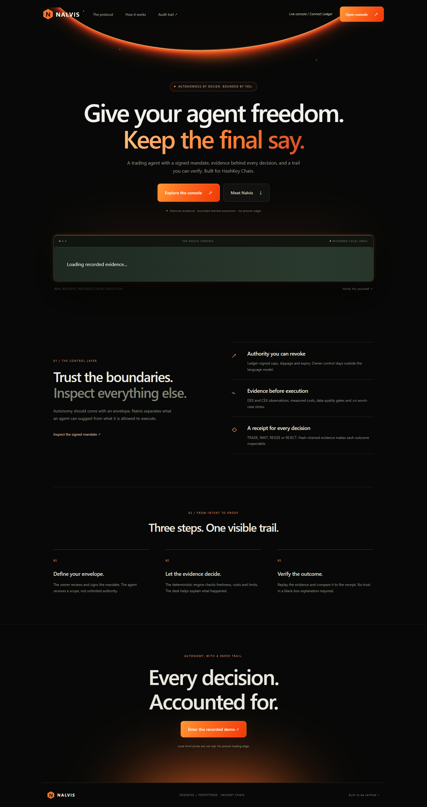
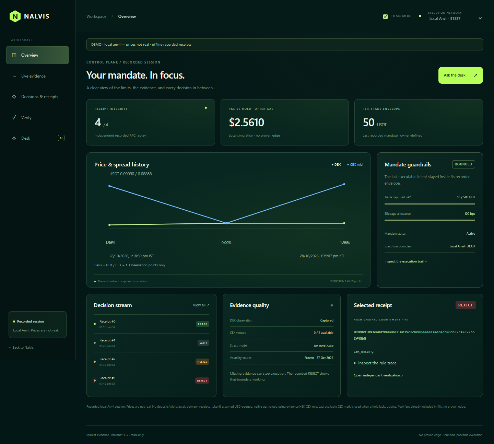
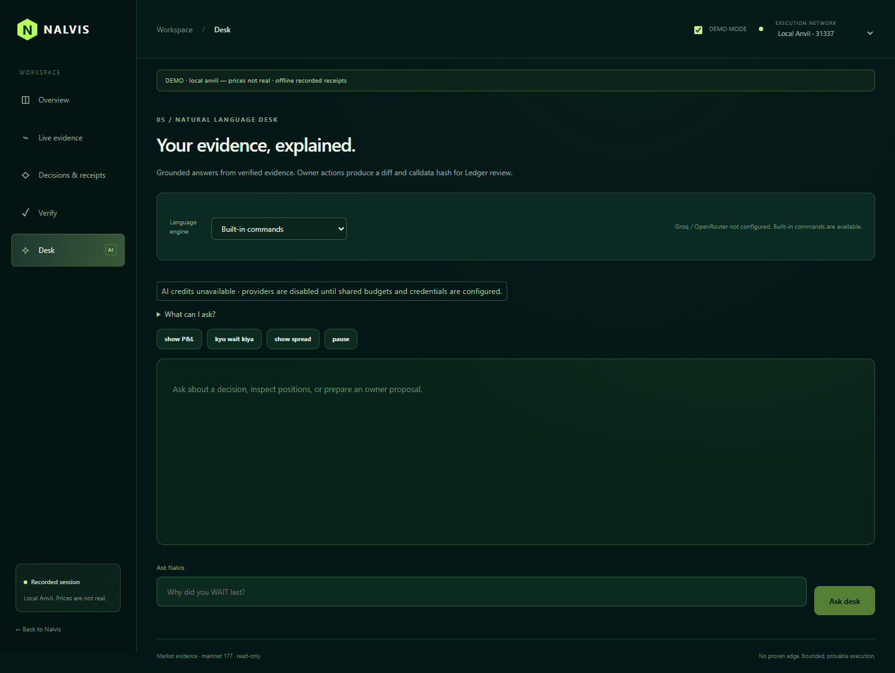
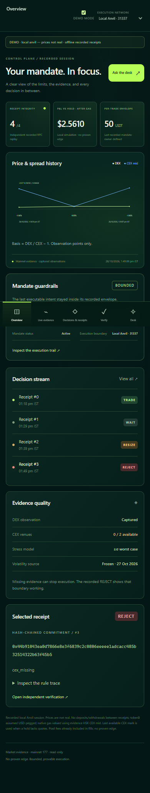

# Dashboard language providers

The landing page uses an ember/black palette; the console uses deep teal and lime. Overview metrics and charts come from the committed T8 recordings, not invented market data. Use `/?demo=1#/mandate` for the recorded console, or `/` for the landing page.

## Configure later

Everything works without AI credentials. `DESK_AI_ENABLED` defaults to **false** (including when absent). The desk defaults to **Built-in commands**. Groq and OpenRouter remain unavailable until all server configuration below is present. Keys stay as empty placeholders in `.env.example`; no provider keys or hosted Redis credentials were added.

Before deliberately enabling AI, set these server variables and redeploy:

- `GROQ_API_KEY` / `GROQ_MODEL`, and optionally `OPENROUTER_API_KEY` / `OPENROUTER_MODEL`.
- `UPSTASH_REDIS_REST_URL` / `UPSTASH_REDIS_REST_TOKEN` (Vercel KV aliases `KV_REST_API_URL` / `KV_REST_API_TOKEN` are also accepted). Use one shared, durable Upstash Redis database for **all instances and both providers**. Separate stores cannot enforce one global cap.
- `DESK_IP_HASH_SECRET`: at least 32 random characters, identical on all instances. Do not rotate it to replenish IP credits.
- Only then set `DESK_AI_ENABLED=true`. Setting it false disables provider calls immediately on the next deployment/runtime configuration update.

Choose a model available to your account that supports JSON object responses. See [Groq models](https://console.groq.com/docs/models), [Groq chat API](https://console.groq.com/docs/api-reference) and [OpenRouter chat API](https://openrouter.ai/docs/api/api-reference/chat/create-a-chat-completion). Model identifiers are not exposed by the status GET endpoint. Never prefix secrets with `VITE_`, put them in the browser, or commit them. For local development use root ignored `.env.local` and restart Vite. Static preview alone does not run server functions; use `pnpm dev` or Vercel hosting.

## Shared rate limits and credits

A single Redis EVAL checks and reserves **all four limits atomically**, using Redis TIME for UTC window boundaries:

| Setting | Default | Scope |
| --- | --- | --- |
| `DESK_AI_IP_PER_MINUTE` | 5 | IP per UTC minute |
| `DESK_AI_GLOBAL_PER_MINUTE` | 30 | All users/providers per UTC minute |
| `DESK_AI_IP_DAILY_CREDITS` | 20 | IP per UTC day |
| `DESK_AI_GLOBAL_DAILY_CAP` | 200 | Hard combined provider-call cap per UTC day |

One credit is one attempted provider call, with at most 256 completion tokens. Reservations happen before calling a provider; failures/timeouts/invalid output consume the reserved credit and are **never refunded or retried automatically**, avoiding uncertain-delivery overspend. The cap counts calls, not dollars; set provider-side financial limits too. Exhausted limits return 429, remaining IP/global daily credits, reset time and retry delay; the desk visibly falls back to built-in commands. GET reads credit status without consuming credits. The script retains used counts when limits are adjusted within a window, and expiring keys do not reset active-window counters.

[Upstash REST commands](https://upstash.com/docs/redis/features/restapi) carry the single EVAL operation; ordinary non-atomic pipelines are not used. Hashed IP keys share a Redis hash slot. There is no in-memory fallback or 1,000-IP cutoff. Missing/malformed store configuration, unavailable storage, invalid responses or uncertain reservations disable AI calls (503).

On Vercel, the server trusts only the platform's overwritten [`x-vercel-forwarded-for`](https://vercel.com/docs/headers/request-headers) header when the platform `VERCEL=1` environment flag is present. Off Vercel, the handler accepts a transport peer address supplied separately by the local Vite adapter; arbitrary forwarded headers are ignored. Other hosts must supply a trustworthy transport identity or calls are disabled. IPs are HMAC-hashed before storage. POST requires an exact same-origin Origin, though Origin alone is not authentication: curl clients can forge it, and the shared IP/global caps still bound them. Credits are per IP, not authenticated users; shared NAT users share a budget. The global cap prevents rotating IPs from creating unlimited provider calls.

## Boundaries and audit

`/api/desk` forwards only the user's text and the supported-command instructions to the selected provider. It never sends receipts, keys, wallet state or portfolio context. The server selects a fixed official endpoint and configured model, validates strict JSON, rejects tool calls and unsupported commands, and returns the normalized command plus SHA-256 prompt/output hashes. The dashboard uses its existing deterministic desk with verified context for the answer and proposal. Transcript hashes appear in the conversation; desk conversations are not keeper decision receipts and do not create on-chain receipts. Existing keeper receipt transcript handling is unchanged.

Users can inspect the interpreted command. Any proposed owner action still requires the exact existing Ledger review, baseline and calldata-hash checks. AI cannot execute a trade, choose a market price, set a recipient, or change an engine verdict. Invalid output and provider errors fall back visibly to the original text and built-in commands. No provider response narrative is shown as market evidence.

Requests are limited to 500 characters, 4 KB bodies, 256 completion tokens and a 12-second provider timeout. Same-origin browser requests are required. Shared limits and budgets are mandatory as described above. Keys and upstream error bodies are never returned or logged.

Tests use mocked provider responses. The actual production Lua runs offline through Fengari against Redis primitive stubs, including concurrent reservations from separate store instances, minute/day rollover and shared global exhaustion. The authenticated hosted Redis REST integration and live provider calls remain **UNVERIFIED until storage and credentials are configured**.

## Design previews

## Live owner route

The landing page retains the recorded-demo entry and adds **Live console / Connect Ledger** at `?demo=0#/mandate`. Explicit `demo=0` overrides the demo build default. Owner controls require a verified deployment/mandate on chain 133 and an owner-enabled build; the hosted build exposes that guarded panel, with no automatic connection/signing. Missing deployments are reported honestly rather than substituted with demo state. No manifest or funded account was invented.

Desk proposals are attached only to their exact desk review. Manual owner reviews clear the pending proposal and do not inherit its hash requirement. Cancel, submission (including failed/cancelled signing), network/demo changes and navigation away clear the pending proposal. Existing target, live mandate, calldata and Ledger checks remain enforced for desk-derived reviews before signing and broadcast.
