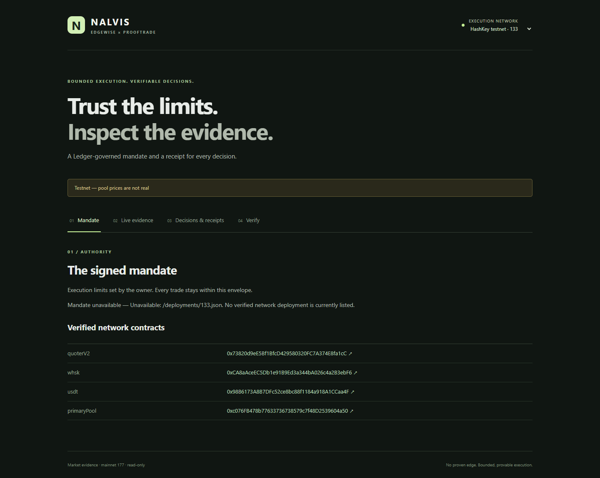
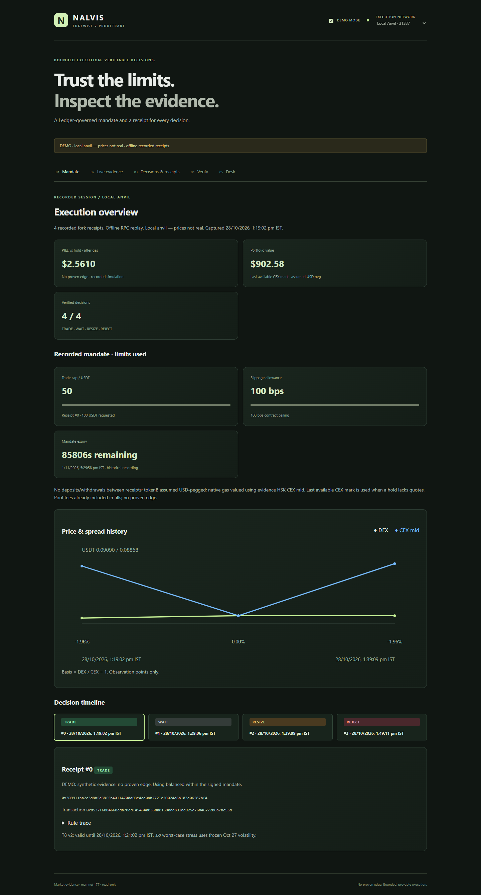
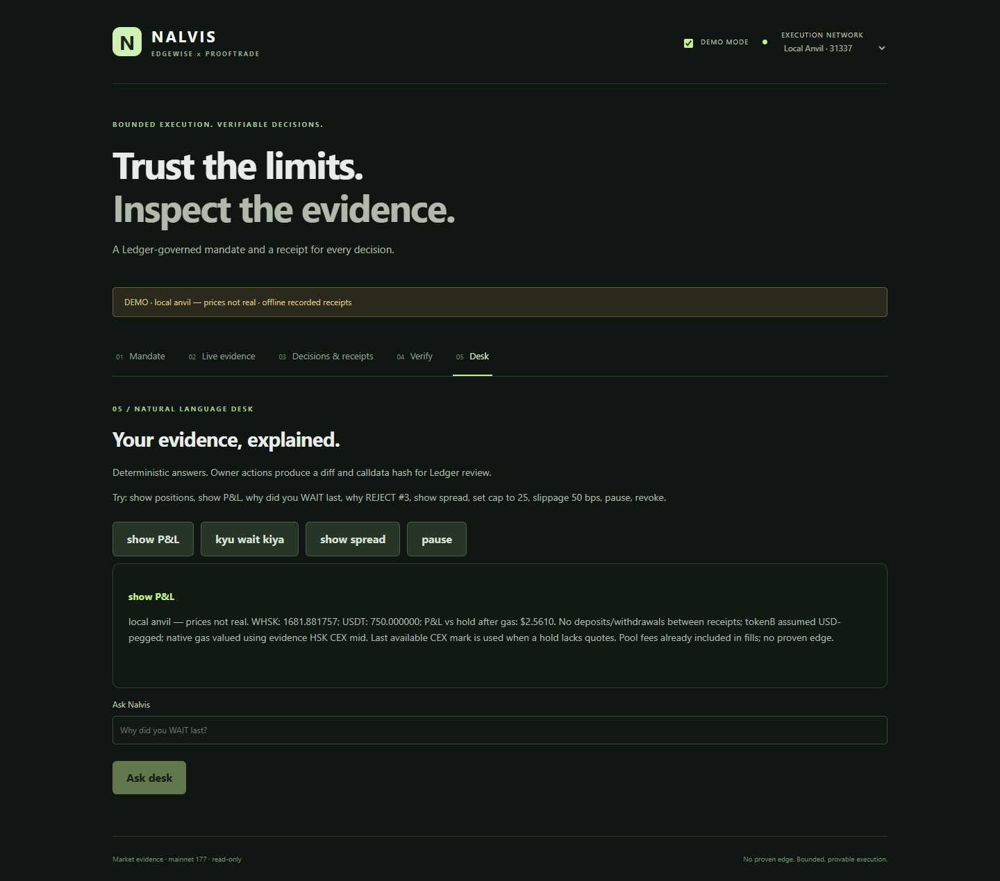
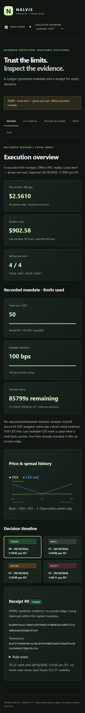

# T8 implementation and verification

Base: merged Task 9 (`a75b29e`). Branch: `t8-desk-ui`. No trading-contract changes; the Solidity edits are to the read-only helper
and its parallel test. No remote writes, and no mainnet signing or broadcasting. Never merge this PR automatically.

## Local preview

Run from repository root:

```powershell
$env:VITE_ENABLE_OWNER='false'
$env:VITE_DEMO_MODE='true'
pnpm --filter @nalvis/dashboard dev --host 127.0.0.1
```

Open http://localhost:5173/?demo=1. All five routes support the same clearly
labelled recorded local-Anvil session. Turn Demo mode off for live read-only
network evidence. Demo mode disables network selection and owner controls.
The chart uses actual captured observation points only. Legacy fixtures have no
risk/expiry fields and are labelled accordingly. The owner panel is not loaded
by the hosted read-only configuration.

## Review fixes

- Replaced redundant 256-draw language and calculation with two-endpoint
  **±σ worst-case stress**. Frozen Oct 27 volatility is labelled in evidence/UI.
- New **v2** receipts require chain-based decisionTime, matching expiry fields,
  volatility input and executable stress results. A v1 allowlist pins exactly
  the four genuine historical T6 commitments; downgrade/field stripping fails.
- Desk proposal handoff to the Owner panel commits every mandate field and
  checks exact calldata hash, target and live baseline before hardware signing
  and again before broadcast. Added pause. No automatic signing is triggered.
- CLI and browser proposals use current vault mandate, pause state and decimals,
  and refuse RPC/policy mismatch. Receipt files sort by numeric sequence.
- Latest priced snapshot selection, corrected REJECT #3 examples, shared real
  v2 Anvil demo recordings, dynamic receipt count and computed expiry display.
- Zero slippage/cap refusals and common Hinglish/unit suffixes covered. Desk
  tests use public Anvil role accounts and connected execution-capability traps.
- Solidity calldata helper accepts explicit parameters for parallel tests;
  unit tests no longer change process-global environment variables.

## Recordings

`packages/verifier/test/fixtures/t8` contains four actual mined local Anvil
transactions on a fork of mainnet block 29413000, all version 2. Every receipt
passed live verification before capture. Price scenarios are synthetic; local
Anvil prices are not real. The T6 recordings remain unchanged and pinned.
No remote broadcast occurred. See the recording README and addresses provenance.

## Validation

Regression coverage includes field stripping/version downgrade, independently
encoded full mandate calldata, current-state tightening, Ledger-time state
changes, pause signing, policy mismatch/RPC errors, numeric sequences above 9,
correct demo CLI examples and server/chain clock separation. Full validation
results are listed in PR #10 after the checks finish.

## Screenshots






## Hosted demo

https://nalvis-hsk-demo.vercel.app — read-only, recorded local Anvil prices.

## External follow-up — UNVERIFIED

Organizer confirmation of testnet-only eligibility remains outstanding. No
Telegram message, reply or screenshot is claimed. Ledger hardware and testnet
broadcasts remain with the project owner. No mainnet signing/broadcast path was
introduced and nothing has been merged into main.
